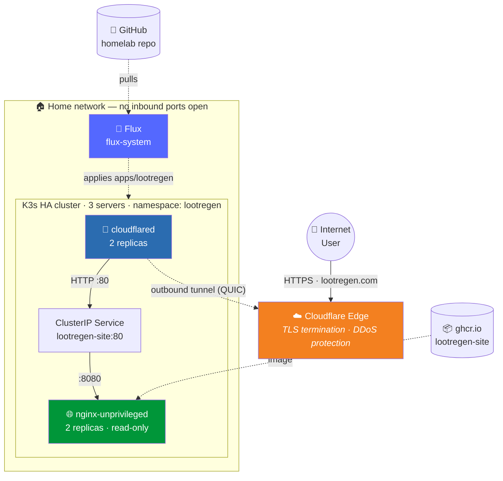

<div align="center">

# 🌐 Lootregen

**Self-hosted personal website on a 3-node K3s cluster — GitOps, zero open ports, zero exposed IPs.**

[](https://k3s.io/)
[](https://www.proxmox.com/)
[](https://fluxcd.io/)
[](https://www.cloudflare.com/products/tunnel/)
[](https://hub.docker.com/r/nginxinc/nginx-unprivileged)
[](LICENSE)

[**🔗 lootregen.com**](https://lootregen.com)

</div>

---

My personal website, self-hosted on a home **K3s** cluster (three servers on three Proxmox laptops) and published through a **Cloudflare Tunnel** — no open ports on the home router, no public IP exposed, valid TLS from Cloudflare's edge.

The site is baked into an **immutable nginx image**, and **Flux** deploys it from my GitOps repo [`homelab`](https://github.com/Lootregenit/homelab). A deploy is a commit that changes the image tag; a rollback is `git revert`.

This repo holds the site and everything needed to build it. The Kubernetes manifests live in the GitOps repo under `apps/lootregen`.

---

## 📖 Table of Contents

- [Why this project](#-why-this-project)
- [Architecture](#-architecture)
- [Stack](#-stack)
- [Repo layout](#-repo-layout)
- [Deploying a change](#-deploying-a-change)
- [Local preview](#-local-preview)
- [Cloudflare Tunnel configuration](#-cloudflare-tunnel-configuration)
- [Debugging cheatsheet](#-debugging-cheatsheet)
- [Hardening and resources](#-hardening-and-resources)
- [Design notes](#-design-notes)
- [History](#-history)
- [What I'd do next](#-what-id-do-next)
- [Teardown](#-teardown)
- [License](#-license)

---

## 💡 Why this project

I originally ran the site as a simple `docker compose` stack on a single VM. It worked, but I wanted to:

- 🎓 Learn Kubernetes on something **real** instead of throwaway tutorials
- 🔁 Practice **GitOps-style deployment** (everything in Git, reproducible)
- 🧹 Get rid of the *"works on my machine"* problem by declaring state as code
- 💼 Build something I'd actually be comfortable putting on a **CV**

So I moved it to K3s on Proxmox at home and kept Cloudflare Tunnel for ingress (no router port-forwarding, free TLS). In October 2026 I rebuilt the whole lab from code (Terraform, Ansible, Flux) and moved the site to real GitOps — see [History](#-history).

---

## 🏗 Architecture



**How a request flows:**

1. User hits `lootregen.com` → resolves to Cloudflare
2. Cloudflare terminates TLS and forwards through the tunnel
3. One of the two `cloudflared` pods receives the request inside the cluster
4. It forwards via the ClusterIP Service to one of the two `lootregen-site` pods
5. nginx serves the static files straight from the image

**How a change gets live:**

```text
edit webpage/ -> git push
  -> image ghcr.io/lootregenit/lootregen-site:<commit>  (Jenkins on K3s; by hand until it runs)
  -> newTag: <commit> in homelab/apps/lootregen/kustomization.yaml
  -> Flux applies it -> rolling update, the PodDisruptionBudget keeps one pod serving
```

> 🔒 **No inbound ports are open on the home network** — the tunnel is an *outbound* connection from `cloudflared` to Cloudflare's edge.

---

## 🧰 Stack

| Layer | Choice | Why |
|---|---|---|
| 🖥 Hypervisor | Proxmox VE 9, 3 nodes | Free, mature, ZFS, backups to Proxmox Backup Server |
| ☸️ Orchestrator | K3s HA: 3 servers, embedded etcd, kube-vip | Any one laptop can go down and the API stays up |
| 🌐 Web server | nginx-unprivileged (Alpine) | Runs as uid 101 on port 8080, fits the restricted Pod Security level |
| 🚪 Ingress | Cloudflare Tunnel, 2 × cloudflared | Free TLS, no port-forwarding, DDoS protection |
| 🔁 Delivery | Flux | Git is the only way into the cluster; drift gets reverted |
| 📦 Images | ghcr.io | One image per commit, tag = commit SHA |
| 🔑 Secrets | SOPS + age | Tunnel token lives encrypted in Git; only the cluster can decrypt it |
| ✅ CI | GitHub Actions | hadolint, build and smoke test on every push |

---

## 📁 Repo layout

```
.
├── README.md
├── Dockerfile            # nginx-unprivileged with webpage/ baked in
├── nginx.conf            # clean URLs, custom 404, caching, security headers
├── .dockerignore
├── Jenkinsfile           # build pod on K3s -> ghcr.io -> tag bump in homelab
├── .github/workflows/
│   └── dockerfile.yml    # hadolint + build + smoke test
└── webpage/              # the site: index.html (EN/DE/PL via ?lang=), blog, posts, 404
```

---

## 🚀 Deploying a change

Once Jenkins runs, a push to `main` is all it takes. Until then, from my PC:

```bash
TAG=$(git rev-parse --short=12 HEAD)
docker build -t ghcr.io/lootregenit/lootregen-site:$TAG .
docker push ghcr.io/lootregenit/lootregen-site:$TAG
```

Then set `newTag: <TAG>` in `apps/lootregen/kustomization.yaml` in the `homelab` repo and push. Flux rolls it out within a few minutes.

**Rollback:** `git revert` the deploy commit in `homelab`.

---

## 👀 Local preview

```bash
docker build -t lootregen-site .
docker run --rm -p 8080:8080 --read-only --tmpfs /tmp lootregen-site
```

Then open http://localhost:8080, http://localhost:8080/?lang=de or http://localhost:8080/?lang=pl.

---

## ☁️ Cloudflare Tunnel configuration

The tunnel is remotely managed. In **Cloudflare Zero Trust → Networks → Tunnels → (tunnel) → Public hostnames**, `lootregen.com` and `www.lootregen.com` point at the in-cluster DNS name:

```
http://lootregen-site.lootregen.svc.cluster.local:80
```

The tunnel token is stored SOPS-encrypted in the `homelab` repo (`apps/lootregen/tunnel-token.sops.yaml`).

---

## 🩺 Debugging cheatsheet

```bash
# What Flux thinks
flux get kustomizations
flux logs --kind=Kustomization --name=apps

# Pods (ideally one per node)
kubectl -n lootregen get pods -o wide
kubectl -n lootregen describe pod <pod-name>

# Logs
kubectl -n lootregen logs deploy/lootregen-site
kubectl -n lootregen logs deploy/cloudflared

# Recent events newest-first
kubectl -n lootregen get events --sort-by='.lastTimestamp'
```

---

## 🛡 Hardening and resources

The `lootregen` namespace enforces the **restricted** Pod Security Standard.

| | lootregen-site | cloudflared |
|---|---|---|
| Replicas | 2, spread across nodes, PDB `minAvailable: 1` | 2, spread across nodes, PDB `minAvailable: 1` |
| User | 101, non-root | 65532, non-root |
| Root filesystem | read-only (emptyDir for `/tmp`) | read-only |
| Privileges | all capabilities dropped, no escalation, seccomp `RuntimeDefault` | same |
| CPU request | 10m | 10m |
| Memory request / limit | 32Mi / 128Mi | 32Mi / 128Mi |

The old Apache setup reserved a full CPU and up to 6 GiB "just in case". A static site needs a few MiB. 🌙

---

## 📝 Design notes

<details>
<summary><b>📦 Site baked into the image instead of a PVC</b></summary>
<br>

The previous version copied the files into a PVC with `kubectl cp`. Fast, but the cluster drifted away from Git, and the files lived on one node's disk. Now every version is an image tag: any node can run it, two replicas need no shared storage, and a rollback is a `git revert`.
</details>

<details>
<summary><b>🔁 Flux instead of deploy scripts</b></summary>
<br>

Nothing reaches the cluster except through Git. Changes made by hand are reverted at the next reconcile, so what's in the repo is what's running.
</details>

<details>
<summary><b>🔑 Token encrypted in Git, not kept out of it</b></summary>
<br>

The tunnel token used to live only in the cluster, created by a script. Now it's in Git, encrypted with SOPS for the cluster's age key, so a rebuilt cluster gets it back on its own and nothing readable is ever committed.
</details>

<details>
<summary><b>⚖️ Two replicas, spread across nodes, with a PodDisruptionBudget</b></summary>
<br>

One laptop can go down, or be drained for updates, and the site keeps serving. The same goes for `cloudflared`.
</details>

<details>
<summary><b>❤️‍🩹 Readiness and liveness probes</b></summary>
<br>

nginx only gets traffic once it answers, and gets restarted if it stops answering. `cloudflared` is checked on its `/ready` endpoint.
</details>

<details>
<summary><b>🔐 TLS terminated at Cloudflare</b></summary>
<br>

Traffic inside the cluster stays HTTP. Simpler, and the hop from cloudflared to nginx never leaves the cluster network.
</details>

---

## 📜 History

| Version | How it ran |
|---|---|
| v1 | `docker compose` on a single VM |
| v2 | K3s, Apache with a `local-path` PVC, files copied in with `kubectl cp`, deployed by scripts (see the git history) |
| v3 · Oct 2026 | Lab rebuilt from code (Terraform, Ansible, Flux); site in an immutable nginx image, deployed by Flux |

---

## 🗺 What I'd do next

- [x] **Flux** for true GitOps — push to Git, the cluster reconciles automatically
- [x] **More K3s nodes** for real HA — three servers now; the site survives a node going down
- [ ] **Jenkins pipeline** — build on K3s, push to ghcr.io, bump the tag (the `Jenkinsfile` is ready)
- [ ] **Prometheus + Grafana + Loki** for observability (response times, error rates, resource usage)
- [ ] **Renovate** to keep image and chart versions current
- [ ] **Ingress + cert-manager** for direct LAN access (cert-manager already runs in the cluster)

---

## 🧨 Teardown

Remove `- lootregen` from `apps/kustomization.yaml` in the `homelab` repo and push. Flux prunes the namespace and everything in it. Nothing is lost: the site lives in the image.

---

## 📄 License

**MIT** — do whatever you want with it.

---

<div align="center">
  <sub>Built at home on Proxmox · Part of the <a href="https://github.com/Lootregenit/homelab">lab-zrh-pve-01 homelab</a></sub>
</div>
